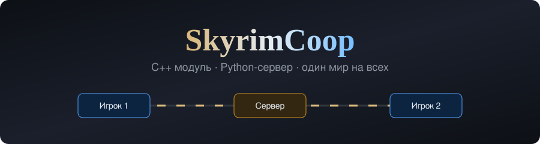
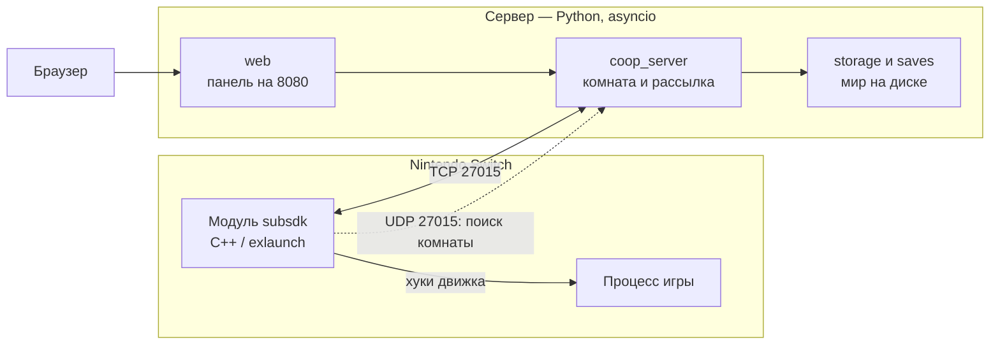

<div align="center">



### Сетевой кооператив для Skyrim на Nintendo Switch: нативный модуль на C++ и авторитарный сервер на Python


</div>

---

##  Содержание

- [ Что это и зачем](#что-это-и-зачем)
- [ Возможности](#возможности)
- [ Архитектура](#архитектура)
- [ Как модуль находит движок](#как-модуль-находит-движок)
- [ Сборка и запуск](#сборка-и-запуск)
- [ Структура проекта](#структура-проекта)
- [ Что не входит в репозиторий](#что-не-входит-в-репозиторий)
- [ История изменений](CHANGELOG.md)
- [ Лицензия и авторы](#лицензия-и-авторы)

---

<a id="что-это-и-зачем"></a>
##  Что это и зачем

**SkyrimCoop** позволяет нескольким игрокам проходить Skyrim вместе на Nintendo Switch. В игре нет сетевого кода, поэтому модуль внедряется в процесс игры, а общее состояние мира хранит отдельный сервер.

Главное решение: **сервер владеет миром, консоль показывает его и присылает действия**. Сервер это одна кампания, и всё, что в ней происходит, общее для всех подключившихся. Подробнее в [docs/world-architecture.md](docs/world-architecture.md).

| Общее для кампании | Личное у каждого игрока |
| :--- | :--- |
| NPC, двери, замки, сундуки, предметы | Персонаж: раса, лицо, имя |
| Стадии квестов и выборы в них | Опыт, навыки, перки |
| Время суток, погода, уровень мира | Инвентарь, золото, снаряжение |
| Общий сундук, торговцы | Заклинания, крики, спутник, лошадь |

>  Проект находится в разработке и проверялся в основном в эмуляторе. Это инженерный эксперимент по реверс-инжинирингу и сетевой синхронизации.

---

<a id="возможности"></a>
##  Возможности

| Категория | Что реализовано |
| :--- | :--- |
| **Подключение** | Поиск комнаты по UDP-широковещанию, вход по IP, пункт «Сетевая игра» в главном меню |
| **Синхронизация** | Положение и анимации, снаряжение, внешность, NPC, магия, снаряды, погода, квесты |
| **Взаимодействие** | Обмен вещами, общий сундук, чат, спутники, ездовые животные, PvP |
| **Интерфейс** | Метки игроков, встроенное меню кооператива, внутриигровая консоль |
| **Сервер** | Постоянное хранение мира, сохранения персонажей, раздача обновлений, веб-панель |
| **Тесты** | `server/test_server.py`, имитация клиента и набор зондов `*_probe.py` |

---

<a id="архитектура"></a>
##  Архитектура



1. Игрок входит в локацию, и консоль запрашивает её состояние у сервера.
2. Сервер присылает, кто мёртв, что вынуто из сундуков и какие двери открыты.
3. Действие игрока уходит на сервер, записывается и рассылается всем, у кого загружена эта локация.

---

<a id="как-модуль-находит-движок"></a>
##  Как модуль находит движок

Функции движка находятся по регистрациям нативных функций Papyrus, а не по жёстко заданным смещениям. Если нужная часть не найдена, модуль остаётся только сетевым и не трогает игру. Для исследования бинарника используются утилиты из `tools/`: разбор RTTI, перекрёстные ссылки, PLT и скрипт для Ghidra.

---

<a id="сборка-и-запуск"></a>
##  Сборка и запуск

### Сервер

```bash
cd server
docker compose up -d        # панель: http://<адрес-пк>:8080
```

Без Docker нужен Python 3.12 и `aiohttp`:

```bash
cd server
python main.py --name "Комната" --port 27015 --web-port 8080
```

### Клиент

Для сборки нужен [devkitPro](https://devkitpro.org/) с devkitA64. Модуль рассчитан на Skyrim 1.1.177 для Nintendo Switch.

```bash
cd client
make
```

Результат появится в `client/deploy/`, путь для развёртывания задаётся в `client/config.mk`.

---

<a id="структура-проекта"></a>
##  Структура проекта

```text
.
├── client/                    модуль для игры
│   └── source/
│       ├── program/coop/      логика кооператива
│       └── lib/, nn/, rtld/   основа exlaunch
├── server/                    сервер, панель, тесты, Docker
├── tools/                     утилиты реверс-инжиниринга
└── docs/                      архитектура мира
```

---

<a id="что-не-входит-в-репозиторий"></a>
##  Что не входит в репозиторий

Здесь нет файлов игры, ключей консоли, эмулятора и готовых сборок. Для работы нужна собственная законно приобретённая копия игры. Проект не связан с Bethesda или Nintendo, все товарные знаки принадлежат их владельцам.

---

<a id="лицензия-и-авторы"></a>
##  Лицензия и авторы

[GPL-2.0](LICENSE), потому что клиент основан на [exlaunch](https://github.com/shadowninja108/exlaunch) и коде Atmosphère. Сведения об основе клиента находятся в [client/EXLAUNCH.md](client/EXLAUNCH.md).
